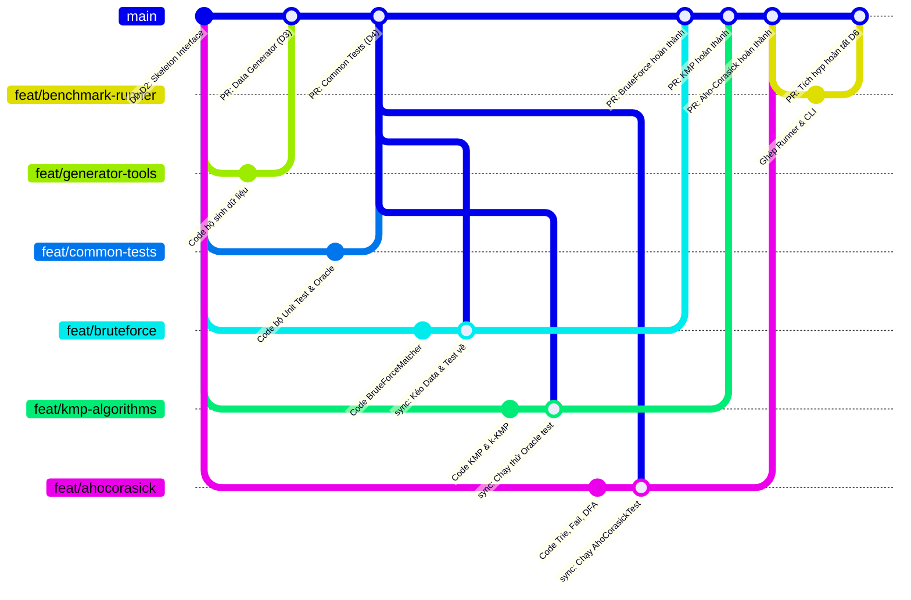

# HƯỚNG DẪN QUY TRÌNH LÀM VIỆC VỚI GIT & PHÂN CHIA NHÁNH (BRANCHING GUIDE)
**Dự án:** Nhóm 4 - CSD201 (Fall 2026)  
**Đề tài 3:** Tìm mẫu trong log lớn: Brute Force, KMP và Aho–Corasick  
**Tài liệu tham chiếu:** [PHAN_CONG.md](PHAN_CONG.md)

---

## I. HIỂU ĐÚNG VỀ NHÁNH (GIT BRANCH) TRONG DỰ ÁN

1. **`feat/` có phải là thư mục trong máy tính không?**
   * **KHÔNG.** `feat/` hoàn toàn không phải là thư mục (folder) trên ổ cứng máy tính.
   * `feat/` là viết tắt của **Feature** (Tính năng mới) – một quy ước đặt tên nhánh chuẩn quốc tế.
   * Dấu gạch chéo `/` giúp GitHub, VS Code hoặc NetBeans tự động gom các nhánh có cùng tiền tố lại thành một nhóm cho gọn gàng.
   * Các tiền tố nhánh chuẩn của nhóm:
     * `feat/`: Làm chức năng, thuật toán, công cụ mới.
     * `test/`: Viết hoặc bổ sung bộ testcase.
     * `fix/`: Sửa lỗi phát sinh.
     * `docs/`: Soạn thảo Paper IEEE, vẽ đồ thị hoặc viết tài liệu.

2. **Nguyên tắc "Vàng" bảo vệ nhánh `main`:**
   * Nhánh `main` là nhánh nộp bài cho Giảng viên, chứa phiên bản code chuẩn và chạy ổn định nhất.
   * **Tuyệt đối không ai được `git push` trực tiếp lên `main`**.
   * Mọi cập nhật vào `main` đều phải thông qua **Pull Request (PR)** trên GitHub và được cặp phản biện chéo (Cross-Review) bấm Approve (Đồng ý).

---

## II. BẢNG PHÂN CHIA NHÁNH CHI TIẾT THEO PHÂN CÔNG (D3 – D6)

Dựa theo bảng phân công công việc chi tiết, nhóm chia thành 8 nhánh chức năng cụ thể:

### 🟢 1. Nhóm nhánh công cụ dùng chung (Ưu tiên làm & Merge sớm ở D3 – D4)
*Vì các cặp làm thuật toán cần dữ liệu và testcase để chạy thử, 3 nhánh này cần hoàn thành và merge vào `main` càng sớm càng tốt:*

| Tên nhánh Git | Người phụ trách | File đảm nhận | Mục tiêu |
| :--- | :--- | :--- | :--- |
| **`feat/generator-tools`** | TV2 (Cặp 1) | `src/generator/LogGenerator.java`<br>`src/generator/RandomByteGenerator.java`<br>`src/generator/WorstCaseGenerator.java`<br>`src/generator/HashUtils.java` | Sinh các bộ dữ liệu thực nghiệm $T_1$ (Log), $T_3$ (Random byte), $T_4$ (Worst case). |
| **`feat/common-tests`** | TV4 (Cặp 2) | `test/FixedCasesTest.java`<br>`test/RandomOracleTest.java` | Viết 5 ca test bắt buộc và bộ $10^4$ test ngẫu nhiên đối chiếu Oracle `String.indexOf`. |
| **`feat/pattern-extractor`** | TV5 (Cặp 3) | `src/generator/PatternExtractor.java` | Rút trích $k$ mẫu ngẫu nhiên từ log ($k \in \{1, 10, 100, 1000\}$). |

---

### 🔵 2. Nhóm nhánh thuật toán lõi (Làm song song từ D3 – D5)
*Mỗi cặp code trên không gian riêng, không đụng chạm file của nhau:*

| Tên nhánh Git | Người phụ trách | File đảm nhận | Mục tiêu |
| :--- | :--- | :--- | :--- |
| **`feat/bruteforce`** | Phương Khánh (Cặp 1) | `src/algorithms/BruteForceMatcher.java`<br>`src/algorithms/LibReadMatcher.java`<br>`test/BlockBoundaryTest.java` | Thuật toán Brute Force quét theo block và đệm $m-1$ byte. Đo chi phí đọc đĩa `lib-read`. |
| **`feat/kmp-algorithms`** | Hoài Nhi (Cặp 2) | `src/algorithms/KMPMatcher.java`<br>`src/algorithms/MultiKMPMatcher.java` | Bảng $\pi$ KMP giữ trạng thái $j$ qua block và thuật toán đa mẫu $k$-KMP. |
| **`feat/ahocorasick`** | Triều Vỹ & Bảo Trâm (Cặp 3) | `src/algorithms/ahocorasick/ACTrieNode.java`<br>`src/algorithms/ahocorasick/ACFailMatcher.java`<br>`src/algorithms/ahocorasick/ACDFAMatcher.java`<br>`test/AhoCorasickTest.java` | Cây Trie, duyệt BFS dựng Failure/Output Link, ma trận DFA `int[states][256]`. |

---

### 🟣 3. Nhóm nhánh tích hợp & Báo cáo (D5 – D6)

| Tên nhánh Git | Người phụ trách | File đảm nhận | Mục tiêu |
| :--- | :--- | :--- | :--- |
| **`feat/benchmark-runner`** | Phương Khánh (Cặp 1) | `src/runner/BenchmarkRunner.java`<br>`src/runner/MeasurementTask.java`<br>`src/Main.java` | Runner bấm giờ độc lập qua `ProcessBuilder`, JMX đo RAM, xuất CSV 22 cột, CLI `Main`. |
| **`docs/paper-and-plots`** | Bảo Trâm & Triều Vỹ (Cặp 3) | `paper/Group4_Paper.docx`<br>`bench/plot_scripts/plot_results.py` | Viết Paper theo mẫu IEEE, chuẩn bị script Python vẽ đồ thị từ CSV. |

---

## III. SƠ ĐỒ DÒNG CHẢY GIT (GIT GRAPH WORKFLOW)



---

## IV. CẨM NANG THAO TÁC GIT TỪNG BƯỚC CHO THÀNH VIÊN

### Bước 1: Cập nhật nhánh `main` và tạo nhánh riêng của mình
Trước khi bắt đầu code bất cứ tính năng nào, luôn đứng ở `main` để kéo code mới nhất về:
```bash
# 1. Chuyển về nhánh main
git checkout main

# 2. Lấy code mới nhất từ GitHub
git pull origin main

# 3. Tạo nhánh mới của bạn (ví dụ Cặp 2 làm KMP)
git checkout -b feat/kmp-algorithms
```

---

### Bước 2: Viết code và commit thường xuyên
Trong quá trình code, hãy commit từng phần nhỏ có ý nghĩa:
```bash
# Xem các file bạn vừa thay đổi
git status

# Thêm các file thay đổi vào staging
git add src/algorithms/KMPMatcher.java

# Tạo commit với thông điệp rõ ràng
git commit -m "feat: implement failure function pi table for KMP"

# Đẩy nhánh của bạn lên GitHub
git push -u origin feat/kmp-algorithms
```

---

### Bước 3: Lấy dữ liệu và testcase mới từ `main` về nhánh mình (Đồng bộ)
Khi Cặp 1 hoặc Cặp 2 vừa merge xong bộ sinh dữ liệu hoặc testcase vào `main`:
```bash
# Đang đứng tại nhánh của bạn (ví dụ feat/kmp-algorithms)
# Kéo những cập nhật mới nhất của main về nhánh mình:
git fetch origin
git merge origin/main
```
*Lúc này trên máy bạn sẽ có ngay toàn bộ file testcase và generator mới nhất để chạy thử code của mình.*

---

### Bước 4: Tạo Pull Request (PR) và Phản biện chéo (Cross-Review)
Khi nhánh của bạn đã hoàn thành và vượt qua toàn bộ unit test:
1. Vào trang repository trên GitHub: `GROUP_4_CSD201`.
2. Bấm vào nút **Compare & pull request** màu xanh.
3. Chọn:
   * **base:** `main` $\leftarrow$ **compare:** `feat/<tên-nhánh-của-bạn>`.
4. Đặt tiêu đề PR và mô tả ngắn gọn những gì đã hoàn thành.
5. Gán Reviewer theo đúng quy tắc phản biện chéo trong `PHAN_CONG.md`:
   * Nhánh của **Cặp 1** $\to$ Gán thành viên **Cặp 2** review.
   * Nhánh của **Cặp 2** $\to$ Gán thành viên **Cặp 3** review.
   * Nhánh của **Cặp 3** $\to$ Gán thành viên **Cặp 1** review.
6. Cặp phản biện kiểm tra code $\to$ Bấm **Approve** $\to$ Bấm **Merge pull request**.

---

### Bước 5: Dọn dẹp nhánh sau khi đã Merge thành công
Sau khi nhánh của bạn đã được gộp vào `main`:
```bash
# Chuyển về main
git checkout main
git pull origin main

# Xóa nhánh cũ trên máy cục bộ để đỡ rối
git branch -d feat/kmp-algorithms
```

---

## V. QUY TẮC PHÒNG NGỪA VÀ XỬ LÝ CONFLICT (XUNG ĐỘT CODE)

1. **Quy tắc phòng ngừa:**
   * Mỗi thành viên chỉ chỉnh sửa các file thuộc trách nhiệm phân công của mình.
   * Tuyệt đối không format lại code (Reformat Code / Ctrl+Alt+L) trên những file của người khác viết.
   * Đảm bảo file `.gitignore` đã chặn các thư mục IDE: `.idea/`, `nbproject/private/`, `build/`, `dist/`, `.class`.

2. **Cách xử lý nếu lỡ bị Conflict khi `git merge origin/main`:**
   * Git sẽ đánh dấu đoạn bị xung đột trong file:
     ```java
     <<<<<<< HEAD (Code của bạn)
     int state = 0;
     =======
     int state = -1;
     >>>>>>> origin/main (Code mới trên main)
     ```
   * Mở file đó trong VS Code hoặc NetBeans, chọn giữ lại code đúng, xóa các ký hiệu `<<<<<<<`, `=======`, `>>>>>>>`.
   * Lưu file, sau đó gõ:
     ```bash
     git add <tên_file_vừa_sửa>
     git commit -m "fix: resolve merge conflict with main"
     git push origin <tên_nhánh>
     ```

---

## VI. HƯỚNG DẪN THAO TÁC BẰNG GIAO DIỆN GITHUB DESKTOP (GUI)

Nếu thành viên trong nhóm không quen dùng dòng lệnh Terminal, hãy sử dụng **GitHub Desktop** theo 4 thao tác cực kỳ đơn giản sau:

### 1. Cập nhật `main` và tạo nhánh mới:
1. Nhìn lên thanh trên cùng, bấm vào ô **Current branch** $\to$ Chọn nhánh **`main`**.
2. Bấm nút **Fetch origin** (hoặc **Pull origin**) ở góc trên bên phải để lấy code mới nhất.
3. Bấm lại vào ô **Current branch** $\to$ Bấm nút **New branch**.
4. Nhập tên nhánh (ví dụ: `feat/kmp-algorithms` hoặc `feat/generator-tools`).
5. Bấm **Create branch** $\to$ Bấm tiếp **Publish branch** màu xanh ở góc trên để đẩy nhánh lên GitHub.

### 2. Viết code trong IDE & Commit:
1. Mở NetBeans / VS Code và viết code bình thường trong các file thuộc phân công của mình.
2. Mở GitHub Desktop: Cột bên trái (**Changes**) sẽ tự động liệt kê các file vừa chỉnh sửa.
3. Ở góc dưới cùng bên trái:
   * Điền tóm tắt vào ô **Summary** (ví dụ: `feat: implement pi table for KMP`).
   * Bấm nút **Commit to feat/...** màu xanh.
4. Bấm nút **Push origin** ở góc trên cùng bên phải để đẩy code lên GitHub.

### 3. Đồng bộ dữ liệu & testcase mới từ `main` về nhánh mình:
1. Đảm bảo ô **Current branch** đang ở nhánh của cặp bạn (ví dụ: `feat/kmp-algorithms`).
2. Trên thanh menu trên cùng, chọn **Branch** $\to$ **Merge into current branch...** (hoặc bấm `Ctrl + Shift + M`).
3. Chọn nhánh **`main`** $\to$ Bấm nút **Create a merge commit**.
4. Bấm nút **Push origin** để đồng bộ lên GitHub.

### 4. Tạo Pull Request (PR) nộp bài:
1. Bấm nút **Create Pull Request** (hoặc phím tắt `Ctrl + R`) ngay trên giao diện GitHub Desktop.
2. Trình duyệt web sẽ tự động mở ra trang tạo PR trên GitHub.
3. Chọn Reviewer phản biện chéo và bấm **Create pull request**.

