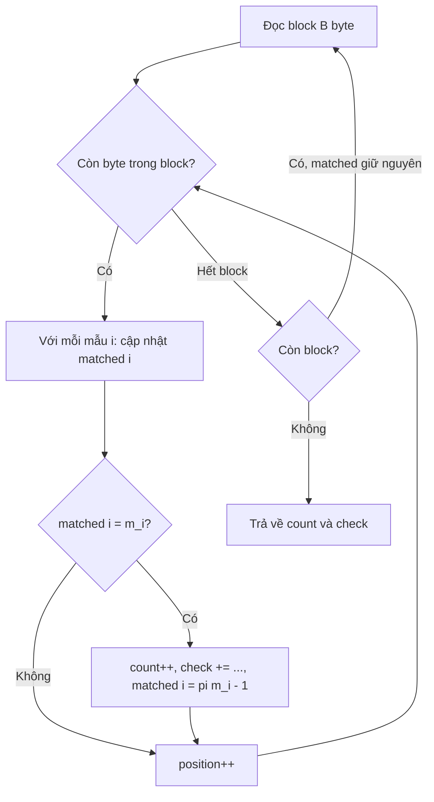

# Thiết kế thuật toán k-KMP

## 1. Mục tiêu

Xây dựng thuật toán **k-KMP** (`kmp-k`) để tìm đồng thời k mẫu trong một file lớn bằng cách **đọc file đúng một lượt**, theo từng block kích thước B. Mỗi byte đọc được cập nhật lần lượt k trạng thái KMP. Chương trình **không đọc file k lần**.

k-KMP là phương án giáo trình làm mốc cho RQ3, để so với Aho–Corasick (hai biến thể `fail` và `dfa`).

## 2. Ý tưởng chính

Với mỗi mẫu cần tìm, chương trình lưu một trạng thái KMP riêng. Các trạng thái này được giữ nguyên khi chuyển sang block tiếp theo.

### 2.1. Bảng mảng trạng thái

| Thành phần | Kiểu | Ý nghĩa | Sống qua block? |
|---|---|---|---|
| `pattern[i]` | `byte[]` | Mảng byte của mẫu thứ i | Có (cố định) |
| `pi[i]` | `int[m_i]` | Bảng prefix (failure) theo giáo trình, dựng một lần trước khi quét (thời gian này ghi vào `build_ms`) | Có (cố định) |
| `matched[i]` | `int` | Số ký tự đã khớp hiện tại của mẫu i. **Đây là trạng thái chính** | **Có** |
| `id` | `int` | Mã mẫu (thứ tự 0, 1, 2, …), dùng khi tính `check` | Có |
| `position` | `long` | Offset byte toàn cục của byte đang xét, tính từ 0 | Có |
| `buffer` | `byte[B]` | Block đang đọc | Dùng lại ở mỗi lần đọc |

Khi chỉ tìm một mẫu thì mã mẫu bằng 0.

### 2.2. Pseudocode cho mỗi byte `c`, với mỗi mẫu `i`

```
m = matched[i]
while m > 0 and c != pattern[i][m]:
    m = pi[i][m-1]
if c == pattern[i][m]:
    m = m + 1
if m == len(pattern[i]):
    start = position - len(pattern[i]) + 1
    count = count + 1
    check = check + (start + 1) * 1000003 + i
    m = pi[i][m-1]            // cho phép kết quả chồng lấn
matched[i] = m
// sau khi xử lý xong tất cả mẫu cho byte này:
position = position + 1
```

## 3. Quy trình xử lý block

1. Đọc block tiếp theo bằng `FileInputStream.read(byte[])` với kích thước B (mặc định 1 MiB).
2. Duyệt từng byte trong block.
3. Với mỗi byte, cập nhật trạng thái của từng mẫu (pseudocode ở mục 2.2).
4. Khi một mẫu khớp hoàn toàn, tăng `count` và cộng vào `check`. Không lưu danh sách vị trí.
5. Hết block: giữ nguyên toàn bộ `matched[]` và `position`, rồi đọc block kế tiếp.
6. Kết thúc khi đã đọc hết file. Trả về `count` và `check`.



## 4. Yêu cầu về tính đúng đắn

- **Không mất, không đếm hai lần** kết quả nằm qua ranh giới block. Lý do: `matched[i]` của từng mẫu và `position` sống qua các block, nên một lần khớp bắt đầu ở block trước và kết thúc ở block sau vẫn được nhận đúng một lần.
- **Đếm các lần xuất hiện chồng lấn.** Lý do: sau mỗi lần khớp đặt `matched[i] = pi[i][m-1]` thay vì về 0.
- **Mẫu rỗng thì báo lỗi.** Ném `IllegalArgumentException` khi dựng trạng thái của mẫu. Block size ≤ 0 cũng báo lỗi.
- **Mẫu dài hơn văn bản thì cho 0 kết quả.**
- **Vị trí kết quả là vị trí bắt đầu**, tính từ 0, theo byte, kiểu `long`.
- **Tìm trên mảng byte**, không giải mã UTF-8. Kiểu `byte` của Java có dấu: so sánh trực tiếp hai byte là đúng; chỉ cần dùng `b & 0xFF` khi byte làm chỉ số mảng. k-KMP so sánh byte trực tiếp nên không dùng byte làm chỉ số.
- **Bộ tiêu thụ kết quả:** `count` tăng 1 mỗi lần khớp; `check` cộng `(vị trí bắt đầu + 1) × 1000003 + mã mẫu` bằng phép cộng `long` cho phép tràn. Phép cộng không phụ thuộc thứ tự báo kết quả, nên `kmp-k` phải cho cùng `count` và `check` với hai biến thể Aho–Corasick khi tìm cùng tập mẫu.

## 5. Độ phức tạp

Gọi:
- `n`: số byte của văn bản.
- `k`: số mẫu cần tìm.
- `m_i`: độ dài của mẫu thứ i.
- `B`: kích thước block.

| Chỉ tiêu | k-KMP | Ghi chú |
|---|---|---|
| Dựng bảng prefix | O(Σ m_i) | Ghi vào `build_ms` |
| Thời gian quét | **O(n · k)** | Mỗi byte cập nhật k trạng thái. Với mỗi mẫu, tổng số lần lùi `matched` không vượt quá số lần tăng, nên thao tác trên mỗi trạng thái là O(1) khấu hao |
| Số lần đọc file | **1 lượt** | Không phụ thuộc k. Đây là điểm khác với chạy KMP độc lập k lần (k lượt đọc, cùng O(n · k) thao tác) |
| Bộ nhớ phụ | O(Σ m_i + k + B) | Mẫu, bảng `pi`, k biến `matched`, buffer. Kết quả chỉ tốn O(1) (`count`, `check`) |

**So sánh với Aho–Corasick (cho RQ3):** Aho–Corasick quét trong O(n + Σ m_i + z) thao tác chuyển trạng thái, với z là số lần khớp, nên thời gian quét không tăng theo k như k-KMP. Đổi lại automaton tốn bộ nhớ (hai biến thể `fail` và `dfa` đánh đổi tốc độ quét lấy bộ nhớ). Dự đoán cụ thể sẽ được ghi thành giả thuyết ở kế hoạch D2 và đối chiếu bằng số liệu đo, không dùng số ước đoán.

## 6. Liên hệ với RQ2 (cùng Hải và TV3)

Trên dữ liệu T₄ (toàn byte `a`, mẫu gồm m − 1 byte `a` và một byte `b`):
- Brute Force quay lui sau mỗi lần sai ở byte cuối, nên tốn cỡ **n × m** phép so sánh.
- KMP không quay lui trên văn bản, nên giữ **O(n)** phép so sánh.

Số liệu để giải thích lấy từ lượt `--count` (số phép so sánh byte chia cho số byte văn bản).