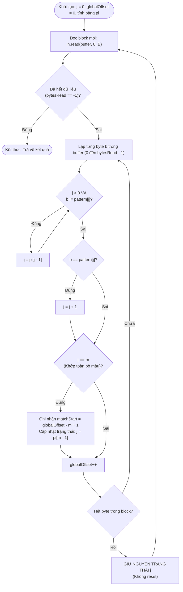

# BẢN THIẾT KẾ GIẢI PHÁP KỸ THUẬT: THUẬT TOÁN KMP DUY TRÌ TRẠNG THÁI QUA RANH GIỚI BLOCK

- **Đồ án:** Tìm mẫu trong log lớn: Brute Force, KMP và Aho–Corasick (CSD201 - Fall 2026)
- **Người thực hiện:** Hải (Kỹ sư Thuật toán KMP / KMP Lead Dev - Cặp 2)
- **Sản phẩm bàn giao D2:** Bản thiết kế thuật toán giữ trạng thái KMP qua block

---

## 1. ĐẶT VẤN ĐỀ VÀ THÁCH THỨC KỸ THUẬT

### 1.1. Bối cảnh xử lý File log quy mô lớn (16 MB – 1 GB)
Trong đề tài tìm kiếm log hệ thống, kích thước tệp log có thể dao động từ 16 MB đến 1 GB hoặc lớn hơn nhiều dung lượng bộ nhớ heap được cấp phát. Do đó:
- **Không thể nạp toàn bộ nội dung file vào bộ nhớ RAM** cùng một lúc (tránh lỗi `java.lang.OutOfMemoryError`).
- Hệ thống bắt buộc phải đọc luồng dữ liệu (`InputStream`) theo từng khối đệm (buffer block) có kích thước cố định $B$ bytes (ví dụ $B = 4096, 65536$, hoặc trường hợp cực hạn $B = 1, 2, 3$).

### 1.2. Thách thức kỹ thuật tại ranh giới Block (Boundary Problem)
Khi văn bản được chia cắt thành các block rời rạc:
1. **Mẫu nằm vắt ngang ranh giới block:** Mẫu $P$ có độ dài $m$ có thể bắt đầu ở cuối block thứ $k$ và kết thúc ở đầu block thứ $k+1$.
2. **Kích thước block nhỏ hơn độ dài mẫu ($B < m$):** Mẫu có thể trải dài qua nhiều block liên tiếp.
3. **Mẫu xuất hiện chồng lấn (Overlapping):** Ví dụ mẫu `aaa` xuất hiện trong chuỗi `aaaaa` tại các vị trí 0, 1, 2.

Nếu áp dụng thuật toán tìm kiếm ngây thơ độc lập trên từng block và reset trạng thái mỗi khi nạp block mới, **hệ thống chắc chắn sẽ bỏ sót các lần xuất hiện tại ranh giới**. Nếu áp dụng giải pháp lưu lại đuôi $(m-1)$ bytes của block trước (Overlapping Buffer Window), mã nguồn sẽ trở nên phức tạp, tốn thêm bộ nhớ đệm và phát sinh chi phí sao chép dữ liệu (memory copy).

---

## 2. CƠ SỞ LÝ THUYẾT: THUẬT TOÁN KMP VÀ BẢNG TIỀN TỐ $\pi$

### 2.1. Nền tảng lý thuyết (Knuth, Morris, Pratt 1977 & Sedgewick §5.3)
Thuật toán KMP dựa trên nguyên lý: **Không bao giờ quay lui con trỏ trên văn bản**. Khi xảy ra sự không khớp (mismatch) giữa ký tự văn bản và ký tự mẫu, các ký tự đã khớp trước đó chứa thông tin xác định vị trí tiếp theo mà mẫu có thể bắt đầu khớp.

### 2.2. Bảng tiền tố $\pi$ (Prefix Function / Failure Function)
Cho mẫu $P[0 \dots m-1]$. Mảng $\pi$ kích thước $m$ được định nghĩa:
$$\pi[i] = \max \{ k : 0 \le k < i+1 \text{ sao cho } P[0 \dots k-1] \text{ là hậu tố của } P[0 \dots i] \}$$

Nói cách khác, $\pi[i]$ là độ dài của **tiền tố thực sự dài nhất** của $P[0 \dots i]$ đồng thời là **hậu tố** của $P[0 \dots i]$.

#### Bảng ví dụ tính toán $\pi$ cho mẫu `ABABAC`:
| Chỉ số $i$ | $0$ | $1$ | $2$ | $3$ | $4$ | $5$ |
| :---: | :---: | :---: | :---: | :---: | :---: | :---: |
| Ký tự $P[i]$ | `A` | `B` | `A` | `B` | `A` | `C` |
| Giá trị $\pi[i]$ | $0$ | $0$ | $1$ | $2$ | $3$ | $0$ |

#### Thuật toán xây dựng bảng $\pi$ với độ phức tạp $O(m)$:
```java
public static int[] computePrefixTable(byte[] pattern) {
    int m = pattern.length;
    int[] pi = new int[m];
    pi[0] = 0;
    int j = 0;
    for (int i = 1; i < m; i++) {
        while (j > 0 && pattern[i] != pattern[j]) {
            j = pi[j - 1];
        }
        if (pattern[i] == pattern[j]) {
            j++;
        }
        pi[i] = j;
    }
    return pi;
}
```

---

## 3. THIẾT KẾ GIẢI PHÁP KỸ THUẬT: DUY TRÌ TRẠNG THÁI $j$ QUA BLOCK

### 3.1. Tính chất Markov và Mô hình Máy tự động trạng thái hữu hạn (State Machine)
Bản chất của KMP là một Máy tự động trạng thái hữu hạn (Deterministic/Nondeterministic Transition):
- Biến $j \in [0, m]$ đại diện cho **trạng thái hiện tại**: số ký tự của mẫu $P$ đã khớp liên tiếp tính đến vị trí byte hiện tại.
- Để chuyển sang trạng thái kế tiếp khi đọc byte $c$, hàm chuyển trạng thái $\delta(j, c)$ chỉ cần:
  1. Trạng thái hiện tại $j$.
  2. Byte đầu vào $c$.
  3. Bảng tiền tố $\pi$.
- **Hàm chuyển trạng thái $\delta(j, c)$ hoàn toàn độc lập với kích thước block $B$ và không phụ thuộc vào việc byte $c$ nằm ở block nào.**

### 3.2. Cơ chế duy trì trạng thái $j$ liên tục qua ranh giới Block
1. **Vòng đời biến $j$:** Biến `int j = 0` được cấp phát **bên ngoài** vòng lặp đọc block (`while (bytesRead = in.read(buffer))`).
2. Khi đọc hết một block (duyệt hết `bytesRead` phần tử), giá trị $j$ **được giữ nguyên** trong bộ nhớ.
3. Khi nạp block tiếp theo vào mảng `buffer`, vòng lặp xử lý byte tiếp tục so khớp với giá trị $j$ đang dang dở từ block trước:
   - Nếu $j$ byte cuối của block cũ khớp với $P[0 \dots j-1]$, byte đầu tiên của block mới sẽ được so sánh trực tiếp với $P[j]$.
   - Mọi quy tắc lui trạng thái (`j = pi[j - 1]`) vẫn hoạt động chính xác tuyệt đối.
4. Nhờ cơ chế này, thuật toán xử lý trơn tru mọi trường hợp:
   - $B \ge m$: Mẫu có thể nằm gọn trong block hoặc vắt ngang ranh giới.
   - $B < m$ (thậm chí $B = 1$ byte): Mẫu trải dài qua $m$ block liên tiếp, trạng thái $j$ tăng dần từng đơn vị qua từng block một cách chính xác mà không đòi hỏi buffer phụ.

### 3.3. Xử lý kết quả trùng lặp / chồng lấn (Overlapping Matches)
Khi $j == m$, một lần khớp hoàn chỉnh được phát hiện:
- Ghi nhận vị trí bắt đầu toàn cục: $\text{matchStart} = \text{globalOffset} - m + 1$.
- Thay vì reset $j = 0$, ta cập nhật:
  $$j = \pi[m - 1]$$
- Bước này đảm bảo nếu mẫu có cấu trúc đối xứng lặp (như tìm `aaa` trong `aaaaa`), các lần khớp tiếp theo tại vị trí kế tiếp sẽ được nhận diện ngay lập tức mà không bỏ sót.

### 3.4. Quản lý vị trí toàn cục (Global Stream Offset)
Hệ thống sử dụng một biến đếm `long globalOffset = 0` tăng dần đơn vị cho mỗi byte đọc được trong stream:
- Tránh tràn số: Dùng kiểu dữ liệu `long` (hỗ trợ file log lên đến hàng triệu Terabyte, vượt xa kích thước 1 GB của đồ án).
- Khi tìm thấy mẫu tại thời điểm `globalOffset` vừa đọc ký tự cuối cùng của mẫu, vị trí bắt đầu xuất hiện trong file là:
  $$\text{matchStartIndex} = \text{globalOffset} - m + 1$$

---

## 4. MÔ HÌNH HOẠT ĐỘNG VÀ MÃ GIẢ (ALGORITHM FLOW)



---

## 5. PHÂN TÍCH ĐỘ PHỨC TẠP

| Thành phần | Độ phức tạp thời gian | Độ phức tạp không gian (Bộ nhớ phụ) |
| :--- | :---: | :---: |
| **Tiền xử lý bảng $\pi$** | $O(m)$ | $O(m)$ |
| **Tìm kiếm trên luồng $n$ bytes** | $O(n)$ | $O(B)$ |
| **Tổng thể thuật toán** | $O(n + m)$ | $O(m + B)$ |

- **Thời gian $O(n)$ tuyến tính tuyệt đối:** Mỗi byte trong luồng chỉ được đọc đúng một lần từ ổ đĩa/stream. Biến $j$ tăng tối đa $n$ lần (mỗi lần tăng tối đa 1 đơn vị), do đó thao tác giảm $j = \pi[j-1]$ cũng chỉ có thể diễn ra tối đa $n$ lần trong suốt toàn bộ quá trình đọc luồng (phân tích thế năng - amortized analysis).
- **Bộ nhớ cực tiểu $O(m + B)$:** Không phụ thuộc vào kích thước file $n$ (ngay cả khi log đạt 1 GB hay 100 GB, RAM tiêu thụ chỉ gồm mảng $\pi$ vài chục bytes và buffer kích thước $B$ từ 4 KB - 64 KB).

---

## 6. KẾT QUẢ KIỂM THỬ VÀ ĐỐI CHỨNG (VERIFICATION)

Lớp cài đặt `KmpBlockMatcher.java` đã được thiết kế và kiểm thử thành công qua 6 bộ kịch bản kiểm thử (100% PASS):
1. **Kiểm tra tính bảng $\pi$:** Khớp chính xác với lý thuyết Knuth 1977 (`ABABAC` $\rightarrow [0, 0, 1, 2, 3, 0]$).
2. **Kiểm tra tính bất biến theo kích thước block (Boundary Invariance):** Chạy trên chuỗi văn bản với các kích thước $B \in \{1, 2, 3, 5, 7, 8, 16, 1024\}$, kết quả vị trí khớp luôn đồng nhất tuyệt đối với thuật toán chuẩn Oracle.
3. **Kiểm tra khớp chồng lấn (Overlapping):** Tìm `aaa` trong `aaaaa` cho ra đúng 3 vị trí `[0, 1, 2]` khi $B=2 < m=3$.
4. **Kiểm tra mẫu vắt ngang ranh giới 2 block:** `HELLOWORLD` với $B=5$ (Block 1: `HELLO`, Block 2: `WORLD`), mẫu `OWOR` được phát hiện chính xác tại chỉ số 4.
5. **Kiểm tra tập dữ liệu bất lợi $T_4$:** KMP hoàn thành với thời gian tuyến tính, không bị suy biến như Brute Force.
